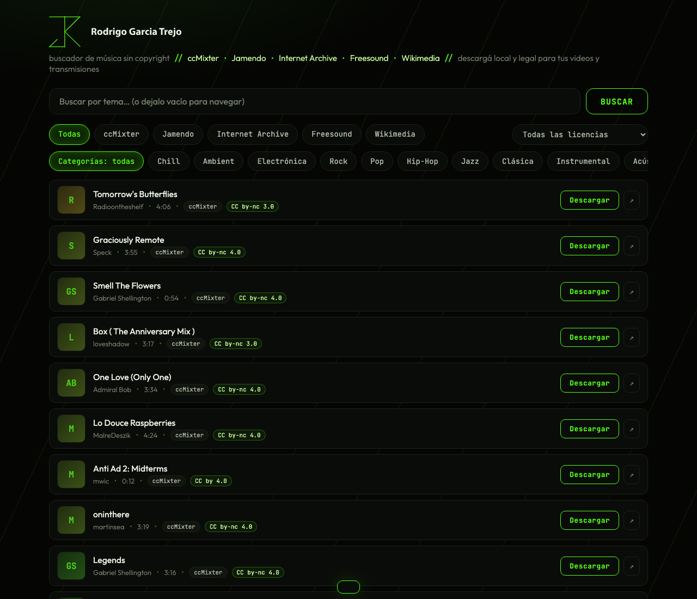
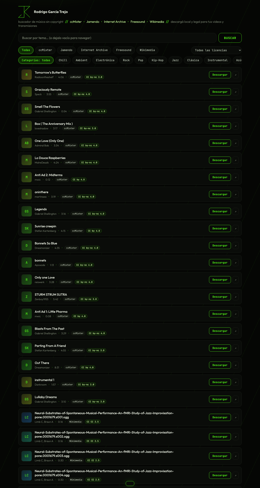

<div align="center">

# 🎧 Busca & Baja

### La caja de música libre para streamers y creadores de contenido

Buscador local de **música sin copyright** (Creative Commons): cinco repos legales
en una sola interfaz, preview al instante y descarga directa a tu compu.

</div>

---

## 🎯 El proyecto

**La finalidad: apoyar a los streamers y creadores de contenido con música lista para usar, sin strikes ni dramas.**

Todo lo que trasmites necesita sonora: los directos de Kick/Twitch, los videos de YouTube,
los cortes de Reels/TikTok… y el panorama real es feo: el servicio de streaming se corta,
no te deja bajar el archivo, y los strikes de copyright pueden tirarte el canal a la mitad
de un directo — con horas de chamba metidas.

**Busca & Baja ataca ese problema por el flanco legal y las 3 de la mañana:**

| El problema del streamer | Cómo lo resuelve |
|---|---|
| Strikes de copyright en los directos | Todo el catálogo es **Creative Commons** — si lo usas conforme a la licencia, no hay nada que reclamar |
| No se puede descargar de los servicios de streaming | Aquí **el archivo se baja y es tuyo**: queda en tu disco y ya no depende de internet ni de sesiones |
| Estar pelando 5 sitios pa' encontrar un theme | **5 repos en una interfaz** con filtro de estilos, vista de lista y preview inmediato |
| ¿Esta rola la puedo usar si monetizo? | Cada tema trae **badge de licencia** y hay filtro de *uso comercial permitido* |
| Crédito del autor: ¿de dónde lo saco? | Botón `↗` en cada tema → página original con los datos para el crédito |

Y como **todo corre en tu máquina** (server local, cero cuentas, cero tracking): tu disquera
es privada, funciona offline una vez descargada, y ningún tercero decide qué puedes oír.

<div align="center">



*Vista general: firma de marca, repos, categorías, lista con badges de licencia y descarga a un clic*

</div>

### ¿Cómo funciona (arquitectura en dos líneas)?

```
navegador (interfaz) → tus clicks → servidor Node local (puerto 5177)
        ↙ busca en los repos (5 APIs, casi todas sin key)    ↘ descarga el MP3 → carpeta music/
```

El navegador conversa con tu `localhost`; el server dialoga con los repos (unifica formatos,
mete una cola anti-throttle, cachea respuestas 10 minutos y hace proxy del audio para que
el preview y la descarga tiren siempre). Tú solo escuchas y bajas.

<div align="center">



*La lista: 20+ temas por repos, con duración, fuente, licencia CC y botón de descarga*

</div>

---

## ▶ ▶ ▶ 【 CÓMO EJECUTAR 】

> **Requisito único**: tener Node 18 o más nuevo (lo demás, nada — cero dependencias npm).
> Verifícalo con `node --version`; si no lo tienes, bájalo de [nodejs.org](https://nodejs.org)
> (instalador gráfico para Windows/macOS, o el maneja de tu distro en Linux).

```bash
# 1. clona el repo (en la carpeta que tú quieras — el proyecto no establece ninguna ruta)
git clone https://github.com/fynio/busca-y-baja.git busca-y-baja

# 2. entra a la carpeta que se creó
cd busca-y-baja

# 3. prende el motor
node server.js
# → Music aggregator on http://localhost:5177
```

4. Abre el navegador: **http://localhost:5177**
5. La app carga sola ~40 temas apenas entras — no necesitas escribir nada para empezar a escuchar y bajar música.

> ⚠️ **Windows**: usa PowerShell o CMD (y los comandos son los mismos). Funciona en las tres
> plataformas porque es Node puro: macOS ✅ · Linux ✅ · Windows ✅.
> La carpeta `music/` se crea sola sobre la marcha en **la carpeta donde corre el server** —
> sin configurar absolutamente nada por sistema operativo.
> Para apagar: `Ctrl + C` en la terminal donde corre.
> Sin internet, la lista queda vacía: toda la música vive en repos remotos.

### Si nunca has usdo una terminal

1. Instala Node desde [nodejs.org](https://nodejs.org) (siguiente, siguiente, instalar).
2. Abre la terminal:
   - **macOS**: app "Terminal" (Cmd+Espacio → teclea "Terminal")
   - **Windows**: menú inicio → teclea "PowerShell"
   - **Linux**: `Ctrl+Alt+T` o la app "Terminal" de tu distro
3. Pega los 3 comandos de arriba uno por uno y Enter luego de cada uno.
4. Abre el navegador y vete a `http://localhost:5177` — listo.

---

## 🧱 Qué trae

| Repositorio | Motor propio | Sin API key | Detalle |
|---|---|---|---|
| **ccMixter** | propio | ✅ sin límites | comunidad de remixes; filtro por tags reales |
| **Wikimedia Commons** | propio (bypass Openverse) | ✅ sin límites | archivos de audio CC + duración real |
| **Internet Archive** (*netlabels*) | propio | ✅ sin límites | ~66.000 lanzamientos netlabel con MP3 directo |
| **Jamendo** | vía Openverse | ⚠️ uso anónimo | carátulas reales; la key lo deja al 100 |
| **Freesound** | vía Openverse | ⚠️ uso anónimo | igual que arriba |

> ⚠️ **Nota**: **Free Music Archive** ya no existe como proveedor de Openverse (el slug `fma`
> regresa un 400 desde 2026) — el equivalente libre en el stack es Internet Archive/netlabels.

Interfaz:
- **Chips por plataforma + categorías** (Chill, Ambient, Electrónica, Rock, Pop, Hip-Hop, Jazz, Clásica…)
- **Vista de lista** con carátula, autor, duración, badge de fuente y **badge de licencia CC**
- **Reproductor fijo abajo** — navegas y bajas sin cortar la rola
- Filtro por **uso comercial** permitido y **modificación** permitida
- Botón `↗` por tema → abre la página original para el **crédito correcto**
- **Estética de marca propia** (verde Kick sobre negro, monograma SVG real, JetBrains Mono)

---

## 🔓 Cómo quitarte el límite de Openverse

Openverse (`api.openverse.org`) tiene un límite horario para usuarios anónimos: si pegas
duro al server con búsquedas seguidas, el upstream se pone lento o se cae. La solución es
gratis y tarda 2 minutos:

1. Créate una cuenta **gratuita** en [api.openverse.org](https://api.openverse.org)
2. Copia tu API key
3. Pégala en [`config.json`](./config.json):

```json
{ "openverseKey": "TU_KEY_AQUI" }
```

Con la key, Jamendo y Freesound responden siempre. Los demás motores (ccMixter,
Wikimedia e Internet Archive) **no la necesitan ni madre**.

---

## 📖 Guía de licencias en 20 segundos

| Badge | Qué significa | ¿Canal monetizado (YouTube/Kick)? |
|---|---|---|
| `CC0` | dominio público | ✅ sin pedir nada |
| `CC by` | usar + atribuir al autor | ✅ con crédito en la descripción |
| `CC by-sa` | igual que `by`, tu remix queda CC | ✅ con crédito |
| `CC by-nc` | **no comercial** | ❌ solo contenido sin monetización |
| `CC by-nc-nd` | no comercial + sin remixes | ❌ ni que estuviera pintado |

**Regla práctica**: ¿tu contenido genera dinero? → filtra por `Uso comercial permitido`
en el selector de arriba y de ahí en adelante, sin pedos.

---

## 🗂 Estructura del proyecto

```
busca-y-baja/
├── server.js           → servidor Node puro (motores de búsqueda, proxy de stream/descarga, caché 10 min)
├── public/
│   └── index.html      → interfaz completa (buscador, filtros, lista, reproductor, footer)
├── config.json         → API key opcional de Openverse
├── docs/img/           → capturas de la interfaz (las de este README)
├── music/              → aquí caen los MP3 que descargas (se genera sola)
└── README.md           → este archivo
```

### Endpoints expuestos (por si quieres scriptear)

| Endpoint | Qué hace |
|---|---|
| `GET /api/search?engine=…&q=…&genre=…&source=…` | búsqueda unificada |
| `GET /api/stream?url=…` | preview de audio (soporta Range) |
| `GET /api/download?url=…&name=…` | descarga a `music/` con nombre + anti-colisión |
| `GET /api/files` · `POST /api/delete?name=…` | listar y borrar lo descargado |

---

## 👤 Creador

**Rodrigo García Trejo — rodrigofynio**

<p align="center">
  <a href="https://kick.com/rodrigofynio">
    
  </a>
</p>

> Transmisiones de música, coding y contenido al 🟢 **todas las semanas en [kick.com/rodrigofynio](https://kick.com/rodrigofynio)** — sigue el canal, métete al directo y saca la mano.

---

<div align="center">
  <em>Diseñado y ejecutado por <b>rodrigofynio</b> — material legal, local y sin drama ©</em>
</div>
